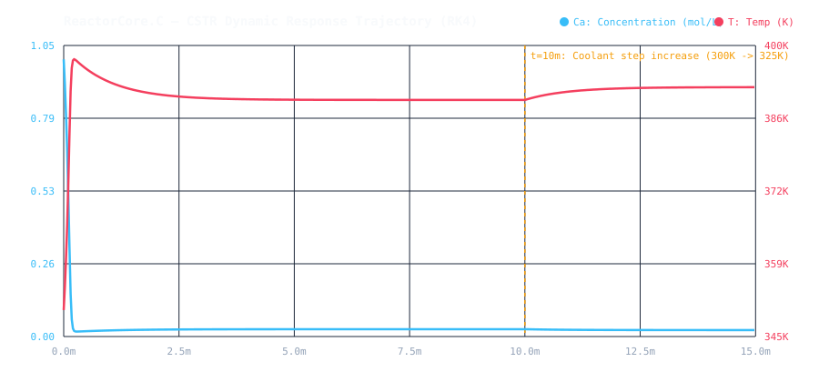

# ReactorCore.C — High-Performance Chemical Reactor Dynamics & ODE Solver

[-00599C?logo=c)](https://en.wikipedia.org/wiki/C11_(C_standard_revision))
[-2ea44f)](#automated-testing)
[](#native-shared-library--c-abi-ffi-export)
[](LICENSE)

**ReactorCore.C** is a high-performance, modular numerical simulation engine built in **C11 (`gcc`)** with zero external library dependencies.

It models coupled, non-linear chemical reactor dynamics — both the classic 2-state exothermic CSTR ($A \to B$) and the stiff 6-state Series-Parallel CSTR with cooling jacket ($A \to B \to C,\ A \to D$) — offering **Explicit RK4**, **SIMD AVX2/FMA batch execution**, **Adaptive RKF45**, and an **L-Stable 3rd-Order Rosenbrock (`ROS3L` / `ROS3L(2)`) stiff solver** with exact analytical Jacobians ($2\times 2$ and $6\times 6$).



---

## Architecture & Systems Programming Highlights

Designed with rigorous low-level systems programming principles:

```text
ReactorCore.C/
├── Makefile                     # Strict GNU Makefile (-std=c11 -Wall -Wextra -Werror -pedantic -mavx2 -mfma -O3 -fPIC)
├── .github/workflows/c-ci.yml   # Automated continuous integration workflow (C11 test + shared lib)
├── include/
│   ├── vector.h                 # Dynamic numerical vector structure and SAXPY primitives
│   ├── rk4.h                    # Generic RK4 & RKF45 engines with workspace pre-allocation
│   ├── cstr.h                   # Coupled 2-state & 6-state Series-Parallel CSTR models + AVX2 batch kernels
│   ├── stiff_solver.h           # L-stable 3rd-order Rosenbrock (ROS3L / ROS3L(2)) stiff integrator
│   └── reactor_ffi.h            # C-ABI Foreign Function Interface header for Python/.NET interop
├── src/
│   ├── vector.c                 # Safe memory allocation, deep cloning, and buffer math
│   ├── rk4.c                    # 4-stage RK4 & Dormand/RKF45 adaptive integration
│   ├── cstr.c                   # Arrhenius rate laws, batch trajectories, and SIMD vectorized kernels
│   ├── stiff_solver.c           # Exact 2x2 & 6x6 analytical Jacobians, LU pivoting, and ROS3L(2) adaptive steps
│   ├── reactor_ffi.c            # Exported FFI implementations for Python (ctypes) and C# (P/Invoke)
│   └── main.c                   # CLI application: runs simulation, logs telemetry, exports CSV
├── tests/
│   └── test_solver.c            # 723 automated assertions (RK4, RKF45, SIMD batch, 6x6 ROS3L stiff stability)
└── docs/
    └── cstr_telemetry.svg       # Generated simulation trajectory diagram
```

### 1. Cache-Friendly Workspace Pre-Allocation (Zero Loop `malloc`)
In high-frequency scientific computing and numerical solvers, calling `malloc()` and `free()` inside tight time-integration loops introduces severe cache misses, heap fragmentation, and overhead.
* `Rk4Workspace` pre-allocates intermediate scratchpad vectors ($k_1, k_2, k_3, k_4, y_{\text{temp}}$) once before entering the simulation loop.
* Memory allocation cost inside the integration loop is **strictly zero** ($O(1)$ amortized memory operations).

### 2. High-Level Extensibility via C Function Pointers
The numerical integrator is fully decoupled from the physical model using idiomatic C function pointers:
```c
typedef void (*OdeSystemFunc)(double t, const Vector *y, Vector *dydt, void *params);
```
Any arbitrary system of first-order differential equations (biological networks, fluid systems, orbital dynamics) can be plugged into `rk4_step()` without modifying the integrator core.

### 3. Strict C11 Compilation & Memory Safety
* Compiles cleanly with `-Wall -Wextra -Werror -pedantic -std=c11 -fPIC`.
* Every allocation includes defensive NULL checks, explicit dimensional assertions, and safe memory deallocation routines.

### 4. Native Shared Library & C-ABI FFI Export (`libreactorcore.so`)
The numerical core can be compiled as a dynamic shared library for zero-overhead integration with high-level languages (Python `ctypes`/`cffi`, C# `DllImport`/P-Invoke):
* **Thread-local workspace**: guarantees thread safety and $O(1)$ stepping with zero heap allocations per step.
* **Batch Trajectory Solver**: simulates full multi-step trajectories in pure C, eliminating Python interpreter loop overhead.

---

## Mathematical & Chemical Engineering Model

The system models an irreversible, exothermic liquid-phase reaction $A \to B$ in a CSTR with jacket cooling:

### 1. Arrhenius Kinetic Law
$$r(T, C_A) = k_0 \exp\left(-\frac{E_a}{R T}\right) C_A$$

### 2. Component Mass Balance
$$\frac{dC_A}{dt} = \frac{q}{V} (C_{A0} - C_A) - r(T, C_A)$$

### 3. Thermal Energy Balance
$$\frac{dT}{dt} = \frac{q}{V} (T_0 - T) + \frac{(-\Delta H_{\text{rxn}})}{\rho C_p} r(T, C_A) - \frac{UA}{V \rho C_p} (T - T_c)$$

### 4. Thermal Runaway & Operating Regimes
Because heat generation is exponential in temperature ($\sim e^{-E_a/RT}$) while heat removal is linear in temperature ($\sim UA(T - T_c)$), the reactor exhibits non-linear phenomena including multiple steady states and thermal runaway under coolant degradation.

---

## Quickstart & Execution

### 1. Prerequisites
* GCC (`gcc`) supporting C11
* GNU Make (`make`)

### 2. Build Native Shared Library
Compiles `libreactorcore.so` for C-ABI interop (FFI with Python / .NET):
```bash
make lib
```

### 3. Run Dynamic Simulation Executable
Compiles and runs the CLI, logging real-time telemetry and exporting `cstr_simulation.csv`:
```bash
make run
```

---

## Automated Testing

Validates dynamic vector operations, analytical decay order of accuracy ($O(\Delta t^4)$), harmonic oscillator energy conservation, CSTR steady states & runaway thresholds, SIMD AVX2/FMA batch integration, adaptive RKF45, and **L-stable `ROS3L`/`ROS3L(2)`** accuracy + stiff runaway boundedness (`dt = 0.08 min`):

```bash
make test
```

```text
=========================================
Running Automated Unit Tests...
=========================================
./test_runner
=========================================
   ReactorCore.C Test Suite (C11)        
=========================================
...
Running test_ros3_stiff_solver (2x2 & 6x6 Exact Jacobian)...
[ROS3L Accuracy] dt=0.025 err=2.753e-02, dt=0.0125 err=4.378e-03, ratio=6.29x
=========================================
Summary: 723 passed, 0 failed
=========================================
```

---

## Author

**Yan Almeida**
- LinkedIn: [linkedin.com/in/yancsa](https://www.linkedin.com/in/yancsa/)
- GitHub: [github.com/yancsalmeida](https://github.com/yancsalmeida)
