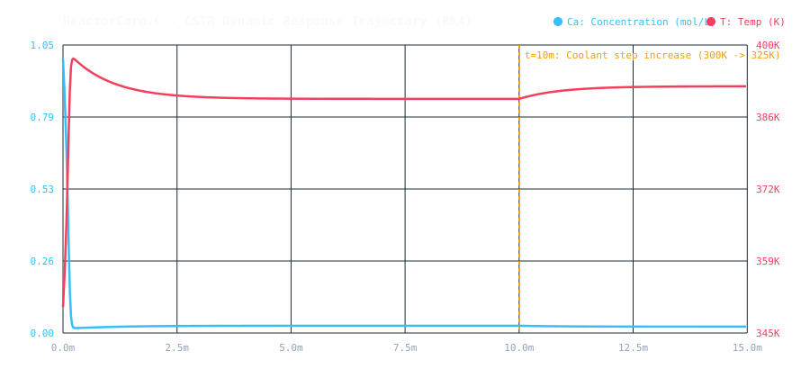

# ReactorCore.C — High-Performance Chemical Reactor Dynamics & ODE Solver

[-00599C?logo=c)](https://en.wikipedia.org/wiki/C11_(C_standard_revision))
[-2ea44f)](#-running-tests--simulation)
[](LICENSE)

**ReactorCore.C** is a high-performance, modular numerical simulation engine built in **C11 (`gcc`)** with zero external library dependencies.

It models the coupled, non-linear dynamic behavior of an **exothermic Continuous Stirred-Tank Reactor (CSTR)** equipped with cooling jacket heat exchange and non-linear Arrhenius kinetics, integrated using a classical **4th-Order Runge-Kutta (RK4)** numerical engine.



---

## 🏗️ Architecture & Systems Programming Highlights

Designed with rigorous low-level systems programming principles:

```text
ReactorCore.C/
├── Makefile                     # Strict GNU Makefile (-Wall -Wextra -Werror -pedantic -std=c11)
├── .github/workflows/c-ci.yml   # Automated continuous integration workflow
├── include/
│   ├── vector.h                 # Dynamic numerical vector structure and SAXPY primitives
│   ├── rk4.h                    # Generic RK4 engine with workspace buffer pre-allocation
│   └── cstr.h                   # Coupled mass & energy non-linear balance equations
├── src/
│   ├── vector.c                 # Safe memory allocation, deep cloning, and buffer math
│   ├── rk4.c                    # 4-stage Runge-Kutta integration implementation
│   ├── cstr.c                   # Arrhenius rate law and differential equations (dCa/dt, dT/dt)
│   └── main.c                   # CLI application: runs simulation, logs telemetry, exports CSV
├── tests/
│   └── test_solver.c            # Automated unit test suite & analytical order-of-accuracy checks
└── docs/
    └── cstr_telemetry.svg       # Generated simulation trajectory diagram
```

### 1. Cache-Friendly Workspace Pre-Allocation (Zero Loop `malloc`)
In high-frequency scientific computing and numerical solvers, calling `malloc()` and `free()` inside tight time-integration loops introduces severe cache misses, heap fragmentation, and overhead.
* `Rk4Workspace` pre-allocates intermediate scratchpad vectors ($k_1, k_2, k_3, k_4, y_{\text{temp}}$) once before entering the simulation loop.
* Memory allocation cost inside the integration loop is **strictly zero** ($O(1)$ amortized memory operations).

### 2. High-Level Extensibility via C Function Pointers
The numerical integrator is fully decoupled from the physical model using idiomatic C function pointers:
```c
typedef void (*OdeSystemFunc)(double t, const Vector *y, Vector *dydt, void *params);
```
Any arbitrary system of first-order differential equations (biological networks, fluid systems, orbital dynamics) can be plugged into `rk4_step()` without modifying the integrator core.

### 3. Strict C11 Compilation & Memory Safety
* Compiles cleanly with `-Wall -Wextra -Werror -pedantic -std=c11`.
* Every allocation includes defensive NULL checks, explicit dimensional assertions, and safe memory deallocation routines.

---

## 🧪 Mathematical & Chemical Engineering Model

The system models an irreversible, exothermic liquid-phase reaction $A \to B$ in a CSTR with jacket cooling:

### 1. Arrhenius Kinetic Law
$$r(T, C_A) = k_0 \exp\left(-\frac{E_a}{R T}\right) C_A$$

### 2. Component Mass Balance
$$\frac{dC_A}{dt} = \frac{q}{V} (C_{A0} - C_A) - r(T, C_A)$$

### 3. Thermal Energy Balance
$$\frac{dT}{dt} = \frac{q}{V} (T_0 - T) + \frac{(-\Delta H_{\text{rxn}})}{\rho C_p} r(T, C_A) - \frac{UA}{V \rho C_p} (T - T_c)$$

### 4. Thermal Runaway & Operating Regimes
Because heat generation is exponential in temperature ($\sim e^{-E_a/RT}$) while heat removal is linear in temperature ($\sim UA(T - T_c)$), the reactor exhibits non-linear phenomena including multiple steady states and thermal runaway under coolant degradation.

---

## 🚀 Running Tests & Simulation

### 1. Prerequisites
* GCC (`gcc`) supporting C11
* GNU Make (`make`)

### 2. Run Automated Test Suite
Validates dynamic vector operations, analytical decay order of accuracy ($O(\Delta t^4)$), harmonic oscillator energy conservation, and CSTR thermal runaway thresholds:
```bash
make test
```
```text
=========================================
Running Automated Unit Tests...
=========================================
./test_runner
=========================================
   ReactorCore.C Test Suite (C11)        
=========================================
Running test_vector_operations...
Running test_rk4_analytical_decay (Order of Accuracy)...
Running test_rk4_harmonic_oscillator_energy...
Running test_cstr_steady_state_and_runaway...
=========================================
Summary: 15 passed, 0 failed
=========================================
```

### 3. Run Dynamic Simulation Executable
Compiles and runs the CLI, logging real-time telemetry and exporting `cstr_simulation.csv`:
```bash
make run
```

---

## 👤 Author

**Yan Almeida**  
BSc in Chemical Engineering (*Budapest University of Technology and Economics — BME*) · Software Development (*ISPGAYA — Porto, Portugal*)  
[LinkedIn](https://www.linkedin.com/in/yan-almeida-66940a381/) · [GitHub](https://github.com/yancsalmeida)
